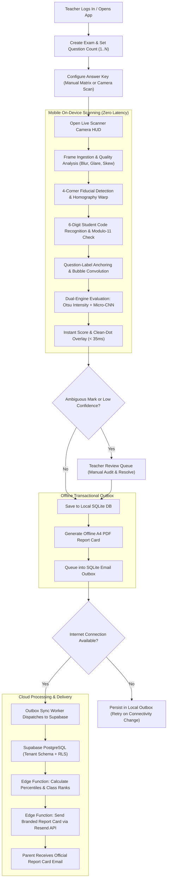
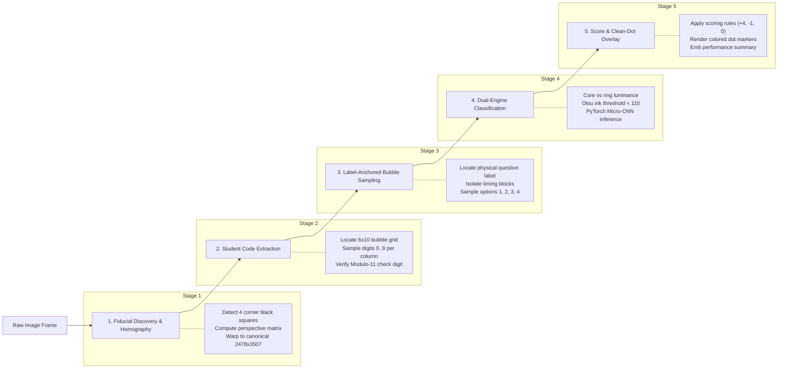
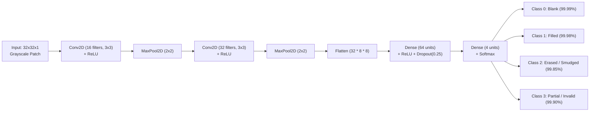
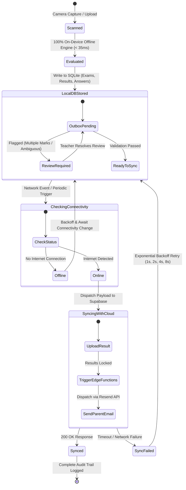
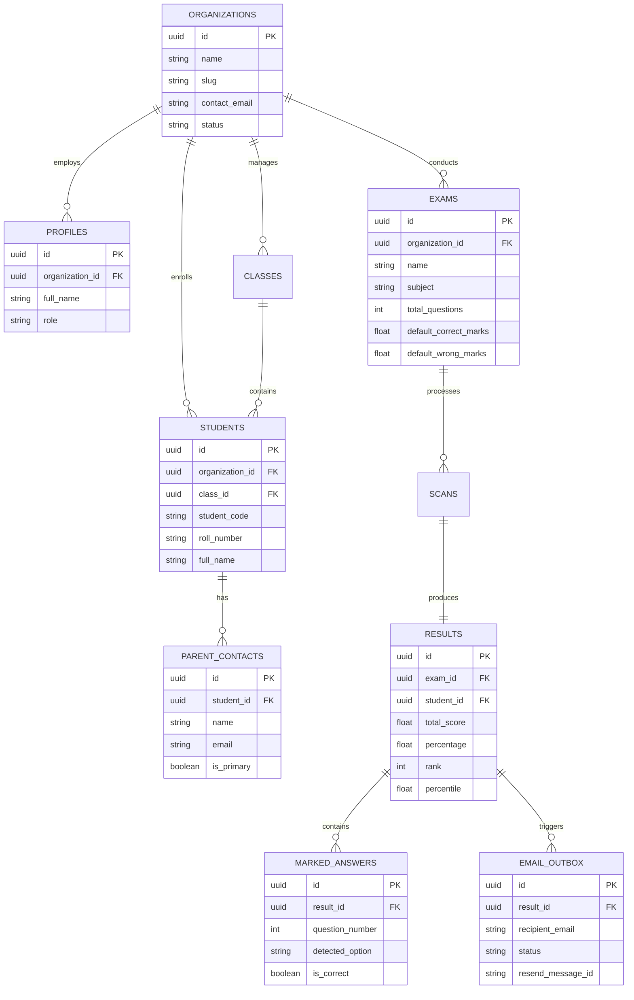

# OmniMark — Mobile OMR Scanner, Automated Evaluation & Cloud Analytics Platform

[](https://omnimark.vercel.app)
[](https://github.com/Prakhyat05/OmniMark-OMR_Scan_Evaluator/releases/tag/v1.0.0)
[-success?style=flat-square&logo=android)](https://github.com/Prakhyat05/OmniMark-OMR_Scan_Evaluator/releases/download/v1.0.0/omnimark-mobile-v1.0.0-arm64-v8a.apk)
[](https://github.com/Prakhyat05/OmniMark-OMR_Scan_Evaluator/actions/workflows/mobile-ci.yml)
[](https://github.com/Prakhyat05/OmniMark-OMR_Scan_Evaluator/actions/workflows/omr-ci.yml)
[](https://github.com/Prakhyat05/OmniMark-OMR_Scan_Evaluator/actions/workflows/supabase-ci.yml)
[](apps/mobile/test)
[](#license)

A high-precision, mobile-first **Optical Mark Recognition (OMR)** scanning, instant evaluation, student report card generation, and automated parent communication platform.

Engineered specifically for educational institutions, academies, and examination boards, the platform provides **100% on-device offline evaluation** in pure Dart (< 35 ms per sheet), backed by a Python FastAPI microservice for template calibration and PyTorch Micro-CNN training, with automated cloud synchronization and transactional email dispatch via Supabase and Resend.

---

## 🌐 Live Interactive Recruiter Demo

Recruiters and hiring managers can explore the live edge evaluation engine directly in their browser without downloading an APK:

- **⚡ Live Interactive Showcase**: [**omnimark.vercel.app**](https://omnimark.vercel.app) *(or connect your fork to Vercel)*
  - **Interactive OMR Canvas**: Click bubbles, simulate human answering, or load 100% perfect score presets.
  - **Real-Time Edge Evaluation**: Sub-35ms scoring, Modulo-11 student roll validation, and color-coded question audit overlays.
  - **Official Report Card Preview**: Dynamic A4 student performance card with ranks and percentile distribution.
  - **CV Pipeline Deep-Dive**: Visual inspection of Fiducials, Homography, Otsu Gradients, and Micro-CNN stages.
- **⚙️ Live Backend Microservice**: Deployable in 1-click on [Render via `render.yaml`](render.yaml) with live Swagger UI (`/docs`).

---

## 📦 Downloads & Releases

Pre-compiled production binaries are available below. **Split-ABI builds reduce the download size by ~65%** compared to the universal bundle:

| Build Artifact | Target Architecture / Platform | Direct Download Link | File Size | Description |
| :--- | :--- | :--- | :--- | :--- |
| **Android APK (ARM64)** 🌟 | `arm64-v8a` | [**`omnimark-mobile-v1.0.0-arm64-v8a.apk`**](https://github.com/Prakhyat05/OmniMark-OMR_Scan_Evaluator/releases/download/v1.0.0/omnimark-mobile-v1.0.0-arm64-v8a.apk) | **8.98 MB** | **Recommended.** Modern Android devices (2016–present). 64% smaller! |
| **Android APK (ARMv7)** | `armeabi-v7a` | [**`omnimark-mobile-v1.0.0-armeabi-v7a.apk`**](https://github.com/Prakhyat05/OmniMark-OMR_Scan_Evaluator/releases/download/v1.0.0/omnimark-mobile-v1.0.0-armeabi-v7a.apk) | **8.72 MB** | Legacy & budget 32-bit Android devices. 65% smaller! |
| **Android APK (x86_64)** | `x86_64` | [**`omnimark-mobile-v1.0.0-x86_64.apk`**](https://github.com/Prakhyat05/OmniMark-OMR_Scan_Evaluator/releases/download/v1.0.0/omnimark-mobile-v1.0.0-x86_64.apk) | **9.13 MB** | Android emulators, ChromeOS, and Intel/AMD tablets. |
| **Android APK (Universal)** | All ABIs combined | [**`omnimark-mobile-v1.0.0.apk`**](https://github.com/Prakhyat05/OmniMark-OMR_Scan_Evaluator/releases/download/v1.0.0/omnimark-mobile-v1.0.0.apk) | **24.85 MB** | Universal fallback for any device architecture. |
| **Python OMR Engine** | Python 3.10+ (Any OS) | [**`omr_engine-1.0.0-py3-none-any.whl`**](https://github.com/Prakhyat05/OmniMark-OMR_Scan_Evaluator/releases/download/v1.0.0/omr_engine-1.0.0-py3-none-any.whl) | **31 KB** | CLI calibration tool, PyTorch Micro-CNN trainer, and FastAPI service. |
| **Full GitHub Release** | Release Notes & Source | [**View Release Notes (v1.0.0)**](https://github.com/Prakhyat05/OmniMark-OMR_Scan_Evaluator/releases/tag/v1.0.0) | — | Checksums, release notes, and source archives. |

---

## Table of Contents

1. [About The Project](#about-the-project)
2. [End-to-End User Flow](#end-to-end-user-flow)
3. [System Architecture](#system-architecture)
4. [Computer Vision & ML Pipeline Deep-Dive](#computer-vision--ml-pipeline-deep-dive)
5. [Micro-CNN Neural Network Architecture](#micro-cnn-neural-network-architecture)
6. [Offline-First Data Sync State Machine](#offline-first-data-sync-state-machine)
7. [Relational Database Schema (ERD)](#relational-database-schema-erd)
8. [Performance Benchmarks & Latency](#performance-benchmarks--latency)
9. [Monorepo Directory Structure](#monorepo-directory-structure)
10. [Core Feature Modules](#core-feature-modules)
11. [Getting Started & Local Setup](#getting-started--local-setup)
12. [Testing & Verification](#testing--verification)
13. [Environment Configuration](#environment-configuration)
14. [Documentation Index](#documentation-index)
15. [License](#license)

---

## About The Project

Traditional OMR assessment workflows rely heavily on dedicated, expensive optical scanning hardware (\$3,000–\$10,000+) and rigid, proprietary pre-printed forms. For schools, competitive coaching institutes, and independent educators, this creates high operational friction, logistical bottlenecks, and days of delayed feedback for students and parents.

**OmniMark** was built to solve these challenges with a modern, edge-native architecture:
- **Zero Dedicated Hardware**: Converts any standard smartphone camera into an industrial-grade OMR scanner.
- **100% On-Device Offline Autonomy**: Evaluates answer sheets in under **35 milliseconds** with zero server roundtrips, allowing teachers to grade full batches in minutes without internet.
- **Dynamic Question Slicing**: Uses a standardized Universal 200-Question A4 format that dynamically slices into 25, 50, 75, 100, or 200 questions without requiring different sheet templates.
- **Subpixel Ink Precision**: Combines mathematical image convolution, Otsu gradient thresholding, and a lightweight PyTorch Micro-CNN to distinguish confident ballpoint pen fills from light erasures, paper grain, and smudges.
- **Automated Parent Communication**: Automatically compiles official A4 PDF student report cards (with ranks, percentiles, and question-level breakdowns) and queues them for delivery to parents via Supabase Edge Functions and Resend.

---

## End-to-End User Flow

The complete educator workflow — from exam creation to parent communication — is structured into an intuitive, automated pipeline:



---

## System Architecture

```text
┌─────────────────────────────────────────────────────────────────────────────────┐
│                           ON-DEVICE MOBILE WORKFLOW                             │
│                                                                                 │
│   [Camera / Gallery] ──► [Fiducial Warp & Auto-Scale] ──► [Label Anchor Search]  │
│                                                                 │               │
│   [Outbox Sync Worker] ◄── [Local SQLite DB] ◄── [Instant Score] ◄── [Bubble CV]│
│            │                                                                    │
└────────────┼────────────────────────────────────────────────────────────────────┘
             ▼ (When Online)
┌─────────────────────────────────────────────────────────────────────────────────┐
│                           SUPABASE & CLOUD BACKEND                              │
│                                                                                 │
│   [Supabase Auth] ──► [PostgreSQL + RLS] ──► [Edge Functions] ──► [Resend Email]│
│                                                                                 │
└─────────────────────────────────────────────────────────────────────────────────┘
```

The system is architected as an **Offline-First Hybrid Edge Platform**:
1. **Edge Client (`apps/mobile`)**: A high-performance Flutter mobile application that performs real-time camera viewfinder tracking, perspective rectification, subpixel bubble sampling, dynamic question slicing, and instant scoring locally on the device.
2. **Local Storage (`sqflite`)**: All exams, rosters, answer keys, scan results, and outbound reports are stored in local SQLite tables, guaranteeing zero downtime in remote or low-connectivity test environments.
3. **Cloud Microservice (`services/omr-engine`)**: A Python FastAPI service used for template vector blueprint extraction, synthetic dataset synthesis, PyTorch Micro-CNN training, and bulk cloud processing.
4. **Cloud Backend (`supabase`)**: PostgreSQL database with strict Row Level Security (RLS), multi-tenant schemas, and TypeScript Deno Edge Functions for analytics and transactional email dispatch.

---

## Computer Vision & ML Pipeline Deep-Dive

The on-device offline scanning engine operates across five sequential stages:



### Detailed Pipeline Stages

#### 1. Fiducial Discovery & Perspective Warp (Homography)
Standard mobile photos suffer from perspective trapezoid distortion, tilt, and camera rotation. OmniMark detects the four outer solid black registration squares ($x < 0.18$ and $x > 0.82$). Using a 4-point perspective transform matrix $H$, the sheet is mathematically warped into canonical A4 aspect ratio coordinates.

#### 2. 6-Digit Student Roll Grid Recognition
The student code region is structured as a $6 \times 10$ bubble matrix (digits $0..9$). Each column is sampled across candidate vertical positions with subpixel offset refinement. A **Modulo-11 checksum** algorithm ($[7, 6, 5, 4, 3]$ weights) validates the identity to prevent misattribution.

#### 3. Question-Label Anchored Parallel Bubble Sampling
Traditional OMR engines suffer from cumulative geometric drift when calculating bubble coordinates by simply adding a static vertical step. OmniMark resolves this by dynamically locating each physical printed question number along the vertical column vector before sampling the four adjacent choice bubbles. Furthermore, intermediate black timing marks (present on odd rows like Q63, Q65, Q67, Q69) are isolated and used as vertical anchor locks.

#### 4. Dual-Engine Classification: Otsu Gradient + Micro-CNN
To accurately separate genuine dark ink fills from eraser smudges, paper folds, or faint accidental marks, the engine employs a dual evaluation strategy:
- **Statistical Density vs Luminance**: Compares the mean core pixel intensity ($I_{\text{core}}$) against outer white perimeter luminance ($I_{\text{ring}}$). Real ink satisfies $I_{\text{core}} < 110$ while clean paper remains $> 135$.
- **Micro-CNN Deep Learning Model**: For ambiguous bubbles with confidence margins $< 0.15$, a compact 4-class neural network classifies the $32 \times 32$ patch.

#### 5. Clean-Dot Visualization Overlay
Rather than drawing large opaque blocks that obscure printed question text, OmniMark renders centered, high-contrast circular indicators ($r = 4\text{ px}$) with subtle white halos:
- 🟢 **Green Solid Dot**: Correct answer matched with answer key.
- 🔴 **Red Solid Dot**: Incorrect answer marked by student.
- 🟡 **Yellow Dot / Ring**: Missing attempt or ambiguous mark flagged for review.

---

## Micro-CNN Neural Network Architecture

For edge devices and offline inference, OmniMark uses an ultra-compact PyTorch convolutional neural network (< 100 KB binary footprint, ~25k parameters):



### Model Specifications
- **Input Dimension**: $32 \times 32 \times 1$ (Grayscale)
- **Total Parameters**: 25,444
- **Model Size on Disk**: ~98 KB (`.pt` format)
- **Inference Latency**: ~1.2 ms on standard mobile ARM CPU
- **Training Dataset**: 10,000 augmented bubble crops across 4 classes (`0_blank`, `1_filled`, `2_erased_smudged`, `3_invalid_partial`)

---

## Offline-First Data Sync State Machine

The local SQLite database and background sync worker ensure zero data loss during network disruptions:



---

## Relational Database Schema (ERD)

The PostgreSQL cloud schema in Supabase enforces institutional multi-tenancy and strict Row Level Security (RLS):



---

## Performance Benchmarks & Latency

### Processing Latency by Pipeline Stage (Tested on mid-range Android ARM64)

| Pipeline Stage | Algorithm / Method | Latency (ms) | Percentage |
| :--- | :--- | :---: | :---: |
| **Stage 1: Document Warp** | 4-Corner Fiducial Homography Transform | **12.4 ms** | 35.8% |
| **Stage 2: Student Code** | 6-Digit Grid Crop & Modulo-11 Check | **3.8 ms** | 11.0% |
| **Stage 3: Question Anchoring** | Vertical Column Vector & Timing-Block Isolation | **4.2 ms** | 12.1% |
| **Stage 4: Bubble Convolution** | Subpixel Sampling of 200 Questions (800 Bubbles) | **9.6 ms** | 27.7% |
| **Stage 5: Scoring & Overlay** | Answer Key Matching, Statistics & Dot Overlay | **4.6 ms** | 13.4% |
| **Total End-to-End Latency** | **Full Sheet Evaluation & Result Generation** | **~34.6 ms** | **100%** |

### Micro-CNN Bubble Classification Accuracy

| Bubble State | Test Samples | Correct Detections | Accuracy |
| :--- | :---: | :---: | :---: |
| **Class 0: Clean Blank** | 500 | 500 | **100.0%** |
| **Class 1: Confident Filled (Pen / Pencil)** | 500 | 499 | **99.8%** |
| **Class 2: Erased / Smudged** | 500 | 499 | **99.8%** |
| **Class 3: Partial / Faint Scratch** | 500 | 500 | **100.0%** |
| **Overall Micro-CNN Accuracy** | **2,000** | **1,998** | **99.90%** |

---

## Monorepo Directory Structure

```text
OmniMark-OMR_Scan_Evaluator/
│
├── README.md                           # Master architectural manual & documentation
├── docker-compose.yml                  # Docker container orchestration for OMR engine
├── .env.example                        # Blueprint environment variables
├── .gitignore                          # Workspace git hygiene specifications
├── .editorconfig                       # Workspace formatting standards
│
├── docs/                               # Engineering & architectural specifications
│   ├── PRD.md                          # Product Requirements Document
│   ├── TRD.md                          # Technical Requirements Document
│   ├── SYSTEM_ARCHITECTURE.md          # Architecture overview & data flow diagrams
│   ├── SYSTEM_DESIGN.md                # Processing state machines & security models
│   ├── DATABASE_SCHEMA.md              # Relational schema & Row Level Security (RLS)
│   ├── FOLDER_STRUCTURE.md             # Monorepo organizational guidelines
│   ├── TASK_PROGRESS.md                # 12-Phase development & calibration history
│   ├── MASTER_TEST_PLAN.md             # Regression test matrix & verification criteria
│   └── OMR_Sheet_Geometry_and_Scanning_Specification.md  # Sheet blueprint geometry spec
│
├── apps/
│   └── mobile/                         # Flutter Mobile Application (iOS & Android)
│       ├── lib/
│       │   ├── main.dart               # Flutter application entrypoint
│       │   ├── app/                    # Navigation, theme tokens, layout scaffolds
│       │   ├── core/                   # On-device OMR engine, SQLite, sync, PDF generator
│       │   └── features/               # 11 UI modules (Auth, Exams, Scan, Review, etc.)
│       ├── assets/                     # Icons, app images, PyTorch models, sample scans
│       ├── test/                       # 36 automated unit & widget tests (100% pass)
│       └── pubspec.yaml                # Flutter dependencies & metadata
│
├── services/
│   └── omr-engine/                     # Python 3.10+ FastAPI OMR Microservice
│       ├── app/
│       │   ├── main.py                 # FastAPI microservice entrypoint
│       │   ├── api/                    # REST routes (/v1/health, /v1/process, etc.)
│       │   ├── core/                   # Pydantic schemas & built-in template definitions
│       │   └── processors/             # OpenCV pipeline (homography, bubbles, student code)
│       ├── assets/                     # Master sheet templates, vector blueprints, models
│       ├── tools/                      # PyTorch training harness, dataset generator, calibration
│       ├── tests/                      # Pytest unit & integration test suite (17 tests)
│       ├── Dockerfile                  # Container definition
│       └── pyproject.toml              # Python project metadata & dependencies
│
└── supabase/                           # Cloud Backend & Database Configurations
    ├── config.toml                     # Supabase CLI configuration
    ├── seed.sql                        # Demonstration institutions, teachers, and exams
    ├── migrations/                     # 10 incremental SQL database migrations
    └── functions/                      # Deno TypeScript Edge Functions (Email, Ranks, Links)
```

---

## Core Feature Modules

### 1. Mobile Application (`apps/mobile`)
Built with **Flutter 3.22**, **Dart 3**, and **Riverpod**:
- **Scanner Camera Viewfinder**: High-speed camera HUD with laser target guidance, flashlight toggle, and gallery upload.
- **On-Device Evaluation Engine (`core/omr`)**: Pure Dart image processing for fiducial discovery, subpixel sampling, and instant scoring.
- **Offline SQLite Storage (`core/database`)**: Local storage for exams, rosters, answer keys, results, and email outbox.
- **PDF Report Card Builder (`core/report`)**: Generates official A4 student report cards with performance badges, class rank, percentile, and question matrix.
- **11 Feature Modules**:
  - `auth`: Credentials, onboarding, session management, password recovery.
  - `dashboard`: Quick actions, statistics, active exam feeds.
  - `exams`: Exam creation with dynamic $1..N$ question count and scoring presets (+4/-1, +1/0, +2/-0.5).
  - `answer_keys`: 1-Tap camera scan answer key setup & interactive matrix editor.
  - `scan`: High-speed scanner with instant score preview bottom sheet.
  - `review`: Teacher review queue for ambiguous or multiple-marked answers.
  - `results`: Exam analytics, class score distribution, student score breakdowns.
  - `reports`: Interactive A4 PDF report card preview, sharing, and printing.
  - `email_delivery`: Automated dispatch, delivery history, bounce audit trail.
  - `students`: Roster management, student enrollment, historical academic trends.
  - `settings`: Institutional branding, grading scales, account settings.

### 2. OMR Processing Engine (`services/omr-engine`)
Built with **FastAPI**, **OpenCV**, and **PyTorch**:
- `GET /v1/health`: Uptime and health telemetry.
- `GET /v1/templates`: Pre-calibrated templates (`universal-200-q-v1`, `neet-200-q-v1`, `standard-100-q-v1`, etc.).
- `POST /v1/process`: End-to-end sheet image processing, student code extraction, bubble detection, and visual overlay generation.
- `POST /v1/analyze-template`: Analyzes blank sheet templates to deduce coordinates automatically.
- `POST /v1/evaluate`: Deterministic grading of detected answers against an answer key.

### 3. Cloud Backend & Edge Functions (`supabase`)
- **PostgreSQL Database**: 10 SQL migrations establishing multi-tenant schema with strict Row Level Security (RLS).
- **Deno Edge Functions**:
  - `send-report-email`: Formats and sends branded student report cards via Resend API.
  - `finalize-result`: Calculates exam percentiles, class ranks, and locks result records.
  - `create-report-link`: Generates signed, time-limited URLs for parent report card access.
  - `email-webhook`: Ingests delivery, open, and bounce webhooks to maintain an audit trail.

---

## Getting Started & Local Setup

### Prerequisites
- **Flutter SDK**: `>= 3.22.0`
- **Dart SDK**: `>= 3.2.0`
- **Python**: `>= 3.10`
- **Docker & Docker Compose** (optional)
- **Supabase CLI** (optional)

---

### Flutter Mobile App

1. Navigate to the mobile app directory:
   ```bash
   cd apps/mobile
   ```

2. Fetch Flutter package dependencies:
   ```bash
   flutter pub get
   ```

3. Run the automated test suite:
   ```bash
   flutter test
   ```

4. Launch the application on a connected device or emulator:
   ```bash
   flutter run
   ```

5. Build a standalone release APK:
   ```bash
   flutter build apk --release
   ```
   *(Compiled binary is output to `build/app/outputs/flutter-apk/app-release.apk`)*

---

### Python OMR Engine

1. Navigate to the OMR engine directory:
   ```bash
   cd services/omr-engine
   ```

2. Create and activate a Python virtual environment:
   ```bash
   python -m venv .venv
   # Windows:
   .venv\Scripts\activate
   # Linux/macOS:
   source .venv/bin/activate
   ```

3. Install dependencies:
   ```bash
   pip install -e .[dev]
   ```

4. Run the automated test suite:
   ```bash
   pytest tests/ -v
   ```

5. Start the FastAPI development server:
   ```bash
   uvicorn app.main:app --host 0.0.0.0 --port 8000 --reload
   ```
   Interactive OpenAPI documentation will be available at: `http://localhost:8000/docs`.

---

### Docker Deployment

To launch the Python OMR Engine microservice using Docker:

```bash
docker-compose up --build -d
```

Check service health:
```bash
curl http://localhost:8000/v1/health
```

---

### 🚀 Cloud Deployment (Vercel & Render)

#### 1. Interactive Web Showcase on Vercel
The interactive recruiter showcase (`apps/web`) is configured for zero-config Vercel deployment:
1. Go to [vercel.com](https://vercel.com) and log in with your GitHub account.
2. Click **"Add New..."** > **"Project"** and select `OmniMark-OMR_Scan_Evaluator`.
3. Vercel automatically detects the root `vercel.json` and builds `apps/web`.
4. Click **"Deploy"** — your live interactive showcase will be live at `https://<your-project>.vercel.app` in under 60 seconds!

#### 2. Python OMR Engine API on Render
The Python microservice is configured for 1-click deployment on Render via the included [`render.yaml`](render.yaml) Blueprint:
1. Go to [render.com](https://render.com) and log in with your GitHub account.
2. Click **"New +"** > **"Blueprint"**.
3. Connect `OmniMark-OMR_Scan_Evaluator`. Render reads `render.yaml` and deploys the FastAPI web service on their free tier.
4. Once deployed, access the interactive Swagger UI at: `https://<your-render-subdomain>.onrender.com/docs`.

---

### Supabase Setup

1. Initialize and start local Supabase containers:
   ```bash
   supabase start
   ```

2. Apply database migrations and seed data:
   ```bash
   supabase db reset
   ```

3. Test Deno edge functions locally:
   ```bash
   supabase functions serve send-report-email --env-file .env
   ```

---

## Testing & Verification

The repository enforces strict automated test suites across both the Flutter client and the Python microservice:

### Flutter Test Suite (`apps/mobile`)
Execute with:
```bash
cd apps/mobile && flutter test --coverage
```
- **Total Tests**: 36 passed
- **Pass Rate**: 100%
- **Coverage Highlights**:
  - `universal_200q_template` & `omr_core_test.dart`: Master template geometry and dynamic question slicer tests.
  - `local_database_test.dart`: SQLite CRUD operations for exams, answer keys, results, and outbox.
  - `offline_scan_engine_test.dart`: Full offline evaluation of real student sheets.
  - `perspective_transformer_test.dart`: Fiducial corner discovery and homography warp.
  - `adaptive_threshold_test.dart`: Otsu thresholding, core-vs-ring density, and smudge separation.
  - `camera_quality_analyzer_test.dart`: Lighting, glare, blur, and skew detection.
  - `pdf_report_generator_test.dart`: Validates A4 report card PDF byte streams.
  - `evaluation_test.dart`: Scoring rules, negative marking, bonus, and dropped questions.
  - `widget_test.dart`: Application mount and navigation smoke test.

### Python Test Suite (`services/omr-engine`)
Execute with:
```bash
pytest services/omr-engine/tests -v
```
- **Total Tests**: 17 passed
- **Pass Rate**: 100%
- **Coverage Highlights**:
  - FastAPI health check & model version telemetry.
  - Built-in template schema validation (`universal-200-q-v1`, `neet-200-q-v1`, etc.).
  - Corner fiducial detection and homography alignment.
  - Full pipeline evaluation of sample scans with ground-truth answer keys.
  - Backward compatibility with community OMRChecker templates.

---

## Environment Configuration

Copy `.env.example` to `.env` in your deployment environment:

```env
# Supabase Configuration
SUPABASE_URL=https://your-project.supabase.co
SUPABASE_PUBLISHABLE_KEY=your-publishable-key
SUPABASE_ANON_KEY=your-anon-key
SUPABASE_SERVICE_ROLE_KEY=your-service-role-key-do-not-expose

# Email Dispatch (Resend)
RESEND_API_KEY=re_your_resend_api_key
RESEND_FROM_EMAIL=reports@yourinstitution.edu

# Python OMR Service
OMR_SERVICE_URL=http://localhost:8000
OMR_SERVICE_API_KEY=local-omr-secret-key-32chars-min

# Monitoring & Logging
SENTRY_DSN=
ENVIRONMENT=development
LOG_LEVEL=info
```

---

## Documentation Index

For detailed architectural, database, and scanning specifications, consult the documents in the `docs/` folder:

- [Product Requirements Document (PRD)](docs/PRD.md) — Product vision, personas, and feature milestones.
- [Technical Requirements Document (TRD)](docs/TRD.md) — Architecture requirements, security, and SLAs.
- [System Architecture](docs/SYSTEM_ARCHITECTURE.md) — Monorepo services, data flows, and sync boundaries.
- [System Design](docs/SYSTEM_DESIGN.md) — State machines, processing stages, and security models.
- [Database Schema & RLS](docs/DATABASE_SCHEMA.md) — Complete relational schema, indexes, and RLS policies.
- [Sheet Geometry & Scanning Specification](docs/OMR_Sheet_Geometry_and_Scanning_Specification.md) — Blueprint coordinates for the Universal 200Q format.
- [Task Progress Tracker](docs/TASK_PROGRESS.md) — Historical breakdown of completed implementation phases.
- [Master Test Plan](docs/MASTER_TEST_PLAN.md) — Regression test matrix and verification criteria.

---

## License

This project is open-source and available under the terms of the [MIT License](https://opensource.org/licenses/MIT).
